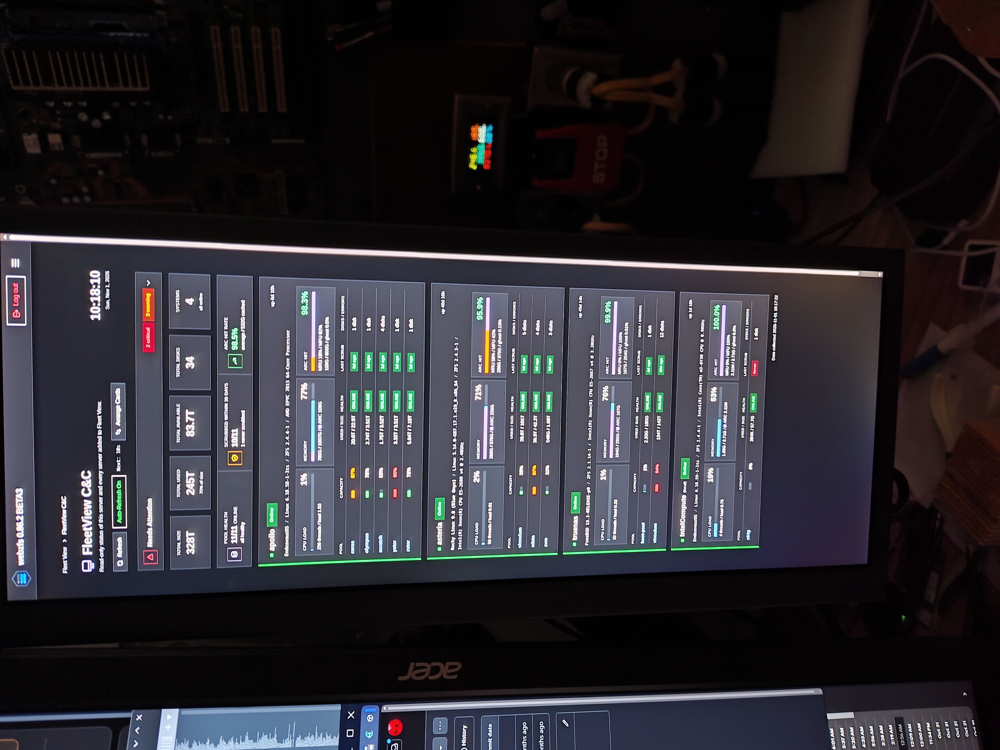
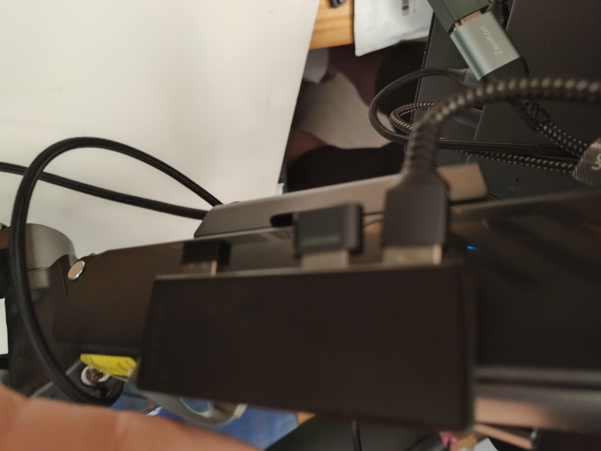
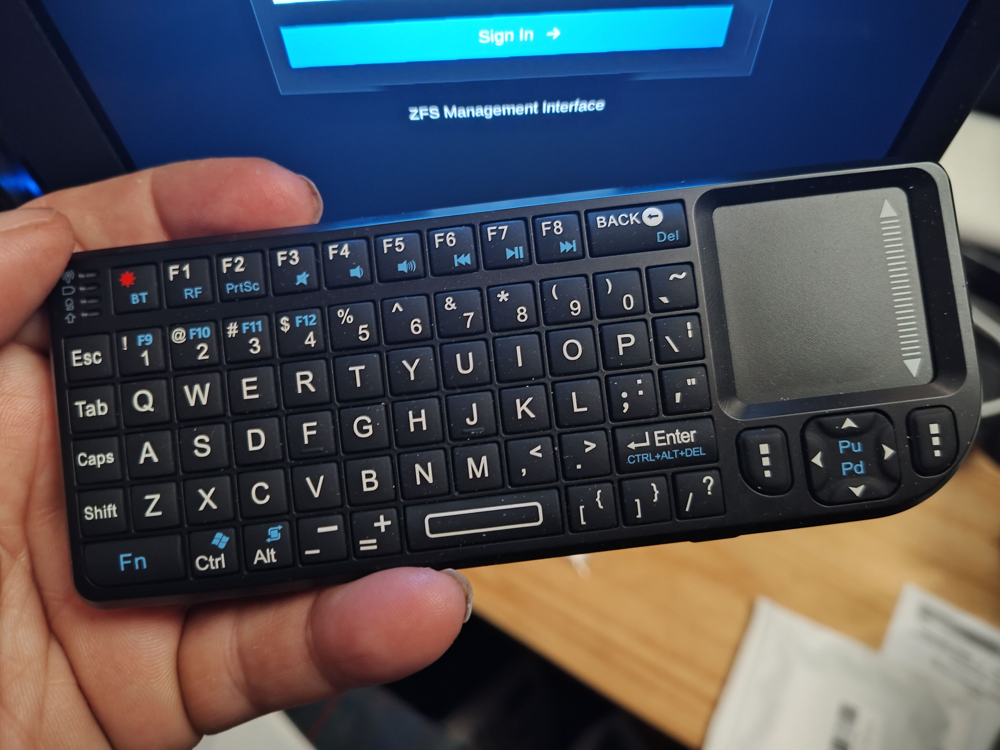
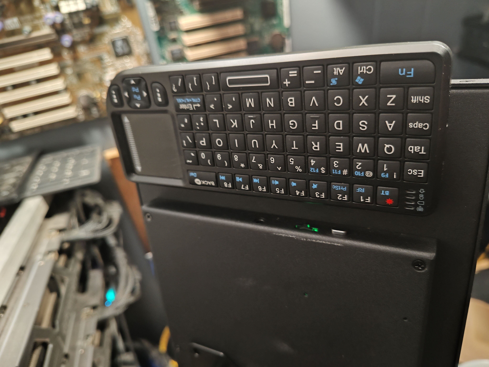

# Making something fun

I've had a pair of odd shaped LCD monitors for a while now that I've had no idea what to use them for. They're 16.2" 2880×1080 touchscreens... basically a mini ultrawide. Well I decided to turn one into a dedicated WebZFS Monitor Monitor. (Yes I worded it that way intentionally)

I had a spare desk mount so I got it all attached and the screen mounted and then dug around and found a spare Intel Compute stick that I had lying around; and then spent about 2 hours trying to find the right adapters in the right shape to get everything hooked up. Let this be a lesson to everyone, you can never have too many odd adapters. 

With a few strips of magnetic tape, I got the compute stick and the little USB hub hooked up and wired up with the monitor.  Why a USB hub? Well because I still need to be able to log in. I hate onscreen keyboards, and while once I'm logged into the UI I could navigate round with the touch screen, I didn't want to use an on-screen keyboard to log in.  I had a little bluetooth mini-keyboard for years that I've never used, so I dug it out and hooked it all up and yea... everything just works. A little bit of magenetic tape on the back of it and i'll mount to the back of the monitor when not in use.

For the keen eye'd among you, there has been a new Fleetview page in WebZFS that I made just for this purpose.  While you can use it on any monitor, I structured it specifically so everything would be available at a glance on this monitor.  One of the privileges of being the main dev on a project, is that you can add in little vanity features like this. haha.

Anyway, some pics.

